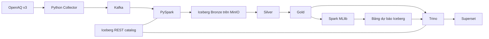

# Kiến trúc và ranh giới thành phần

**Trạng thái:** thiết kế dự kiến, chưa triển khai. File này giải thích kiến trúc; [context](IMPLEMENTATION_CONTEXT.md) ghi mức độ hiện thực và quyết định còn mở.

## Luồng dự kiến

Bronze/Silver/Gold là các lớp bảng logic. MinIO giữ object; catalog giữ tham chiếu metadata bảng. PostgreSQL sẽ phục vụ metadata của Superset và dịch vụ cần nó; backend catalog chưa chốt. Không mặc định PostgreSQL là nơi lưu measurements.

## Trách nhiệm và I/O

| Thành phần | Đầu vào → đầu ra | Trách nhiệm |
|---|---|---|
| config | env/cấu hình → cấu hình đã kiểm tra | Defaults, secrets được che, lỗi cấu hình rõ ràng |
| contracts | metadata/payload → schema/quy tắc | Định danh, thời gian, đơn vị, ingest mode |
| collector | API/khoảng thời gian → event Kafka | Pagination, rate limit, retry, checkpoint, live/backfill/replay |
| processing | event/raw → Bronze/Silver/Gold | Giữ gốc, chuẩn hóa, MERGE, quality, tính lại phần chịu ảnh hưởng |
| forecasting | chuỗi giờ hợp lệ → model/metrics/predictions | Features causal, split thời gian, baseline, model version |
| observability | trạng thái job → log/metrics đã làm sạch | Freshness, gap, tiến độ, lỗi, evidence |
| Trino/Superset | bảng Iceberg → query/dashboard | Truy vấn, hiển thị, cấu hình tái lập |

## Invariant dữ liệu

1. Một measurement là một chỉ số của một sensor; muốn so sánh PM2.5/PM10 phải ghép có ý thức theo trạm/thời gian.
2. Event time khác ingested_at. UTC để lưu, Asia/Ho_Chi_Minh để hiển thị; không dùng timestamp không timezone.
3. Bronze giữ gốc; Silver có thể chạy lại an toàn theo sensor/period_start/period_end. Quy tắc nguồn sửa số đo và tie-break sẽ chốt từ mẫu thật ở P1.
4. Late/corrected data làm cập nhật phần Gold chịu ảnh hưởng; watermark không phải cơ chế dedup duy nhất. Replay có namespace riêng.
5. Không biến thiếu thành 0; coverage/freshness theo sensor. Không nhầm metadata trạm mới với mọi sensor mới.
6. `period.interval` một giờ và nhịp timestamp 5 phút đang chưa được giải thích. Tạm chặn tổng hợp trung bình/chuỗi giờ ML, không chặn lưu gốc hay khảo sát.
7. Features ML chỉ dùng thông tin có tại issued_at; backtest lịch sử tách operational forecast, không giả định ingested_at lịch sử.

## Lưu trữ và kiểm chứng dự kiến

Chọn partition theo mẫu query và dữ liệu thật sau P1; không phân vùng theo sensor một cách máy móc ở dữ liệu nhỏ. Thực nghiệm pruning dựa query plan/scan; compaction dựa file count/size và correctness; time travel dựa snapshot query trước/sau. Giữ snapshot cần cho bằng chứng, không tự expire snapshot hoặc xóa volume.

## Những gì chưa chốt

Version matrix và lock, catalog backend, Kafka topic/schema cụ thể, bảng/partition DDL, correction tie-break, phương pháp tạo chuỗi giờ, cổng/tài nguyên và CLI concrete names. Goal phải khảo sát, chọn, kiểm chứng và ghi quyết định trong log/context trước khi coi đây là triển khai thực tế. Không cần chọn các chi tiết này để hoàn thành scaffold.
